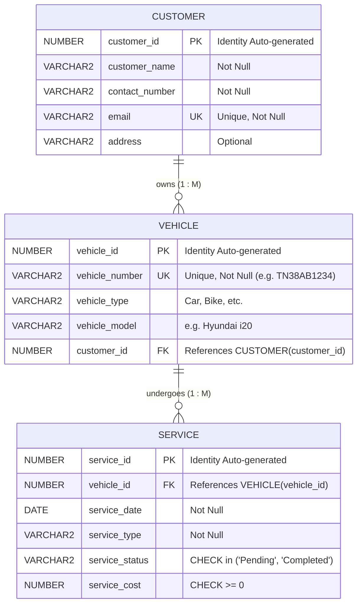

# Vehicle Service Management Database System

**Course:** TN SKILLS – Database Administration Back End – Oracle  
**Platform:** Naan Mudhalvan  
**Project Category:** Relational Database Management System & Full-Stack Web Interface  
**Database Engine:** Oracle Database (12c / 19c / 21c / 23c / 23ai / Express Edition XE)  
**Database Development Tool:** Oracle SQL Developer  

---

## 1. Project Overview & Objectives

The **Vehicle Service Management Database System** is a production-grade relational database solution designed to streamline the operations of a vehicle service center. The system eliminates manual ledger records and paper-based tracking by providing:

1. **Centralized Customer Management:** Track vehicle owners, unique contact information, emails, and residential addresses.
2. **Vehicle Registry:** Associate multiple vehicles with registered customers while enforcing strict referential integrity.
3. **Service Order Lifecycle Tracking:** Record work orders (General Service, Oil Change, Brake Service, etc.), dates, completion status (`Pending` vs `Completed`), and service costs with validation constraints (`service_cost >= 0`).
4. **Analytical Reporting:** Generate live aggregated cost analytics, status-based volume breakdowns, pattern-matched vehicle lookups, and multi-table relational reports.
5. **Interactive Web Dashboard:** A responsive, modern user interface built using Flask, HTML5, CSS3, and JavaScript, communicating with Oracle Database via `python-oracledb`.

---

## 2. Technology Stack

| Layer | Component | Specification |
| :--- | :--- | :--- |
| **Database Engine** | Oracle Database | Oracle Database 19c / 21c / 23ai / XE (Pluggable DB: `XEPDB1` / `FREEPDB1`) |
| **Database Tool** | Oracle SQL Developer | SQL Worksheet, Script Runner (F5), Query Runner (Ctrl+Enter) |
| **Database Language** | Oracle SQL & PL/SQL | DDL, DML, TCL (COMMIT, ROLLBACK, SAVEPOINT), Constraints, Identity |
| **Database Driver** | python-oracledb | Python Driver for Oracle DB (Thin Mode - Zero Oracle Client install) |
| **Backend Framework**| Python 3 / Flask | RESTful routing, parameterized Oracle bind queries (`:param`) |
| **Frontend UI** | HTML5, CSS3, JavaScript | Responsive dashboard, modal dialogues, validation, CSS variables |
| **Configuration** | python-dotenv | Parameterized database connection via `.env` |

---

## 3. Database Design & Entity Relationships

The relational model consists of three normalized tables (`CUSTOMER`, `VEHICLE`, and `SERVICE`) designed in Third Normal Form (3NF).



### Relational Constraints Summary

- **Primary Keys:** `pk_customer`, `pk_vehicle`, `pk_service` (Enforced via `NUMBER GENERATED BY DEFAULT AS IDENTITY`).
- **Foreign Keys:**
  - `fk_vehicle_customer`: `VEHICLE.customer_id -> CUSTOMER.customer_id`
  - `fk_service_vehicle`: `SERVICE.vehicle_id -> VEHICLE.vehicle_id`
- **Unique Constraints:**
  - `uq_customer_email`: Prevents duplicate email registrations.
  - `uq_vehicle_number`: Prevents duplicate vehicle license registrations.
- **Check Constraints:**
  - `chk_service_status`: Ensures `service_status IN ('Pending', 'Completed')`.
  - `chk_service_cost`: Enforces business logic `service_cost >= 0`.

---

## 4. Project Folder Structure

```text
vehicle-service-management/
├── .env                        # Active Oracle connection credentials
├── .env.example                # Example environment configuration
├── requirements.txt            # Python dependencies (flask, oracledb, python-dotenv)
├── app.py                      # Flask web application & REST routes
├── db.py                       # Oracle connection manager (python-oracledb)
├── test_oracle_connection.py   # CLI connectivity test & query verification script
├── test_app.py                 # Automated test suite for Flask routes and views
├── schema.sql                  # Table creation DDL & constraint definitions
├── sample_data.sql             # Sample data population with safe foreign key lookups
├── queries.sql                 # Comprehensive SQL operations script (Sections A-G)
├── full_database_setup.sql     # Master all-in-one script for Oracle SQL Developer (F5)
├── README.md                   # Complete documentation & Naan Mudhalvan checklist
├── static/
│   ├── css/
│   │   └── style.css           # Modern, responsive vehicle dashboard styling
│   └── js/
│       └── main.js             # Client-side validation, modals, and event handling
└── templates/
    ├── base.html               # Master layout with sidebar, navbar, and DB status badge
    ├── dashboard.html          # KPI metrics, revenue, and recent 3-table join services
    ├── customers.html          # Customer list, search, modal form, delete safety alert
    ├── customer_edit.html      # Customer edit profile form
    ├── vehicles.html           # Vehicle registry with owner JOIN and modal form
    ├── vehicle_edit.html       # Vehicle edit details form
    ├── services.html           # Service work orders, status filter, modal form
    ├── service_edit.html       # Service edit form
    ├── reports.html            # Dedicated SQL reports (Aggregates, Group By, 3-Table JOIN)
    └── db_status.html          # Oracle DB diagnostics, live test tool, and setup guide
```

---

## 5. Installation & Environment Configuration

### Step 1: Create and Activate Virtual Environment

```bash
# Navigate to the project directory
cd vehicle-service-management

# Create Python virtual environment
python3 -m venv venv

# Activate on macOS / Linux:
source venv/bin/activate

# Or activate on Windows:
# venv\Scripts\activate
```

### Step 2: Install Python Dependencies

```bash
pip install -r requirements.txt
```

> **Note on `python-oracledb` Thin Mode:**  
> `python-oracledb` operates in pure Python **Thin Mode** by default. It communicates directly with Oracle Database through the Oracle Net Protocol. You do **not** need to install Oracle Instant Client or configure any C libraries.

### Step 3: Configure Oracle Connection in `.env`

Copy `.env.example` to `.env` (or edit the existing `.env`):

```bash
cp .env.example .env
```

Open `.env` in an editor and set your Oracle Database parameters:

```env
FLASK_APP=app.py
FLASK_DEBUG=1
SECRET_KEY=tn-skills-vehicle-management-secret-key-2026

# Oracle Database Credentials
ORACLE_USER=system
ORACLE_PASSWORD=your_oracle_password
ORACLE_HOST=localhost
ORACLE_PORT=1521

# Specify your Pluggable Database (PDB) service name:
# - Oracle Database 23ai Free: FREEPDB1
# - Oracle Express Edition (XE 18c/21c): XEPDB1
# - Oracle Database 19c Enterprise: ORCLPDB1
ORACLE_SERVICE_NAME=FREEPDB1
ORACLE_SID=
ORACLE_DSN=
```

---

## 6. Running SQL Scripts in Oracle SQL Developer

### Option A: Master One-Click Setup (Recommended)

1. Open **Oracle SQL Developer**.
2. Connect to your database connection (e.g., `System_PDB` or your user schema).
3. Open `full_database_setup.sql` via **File &rarr; Open**.
4. Click **Run Script** or press **F5**.
5. The script will drop existing tables safely, create all tables and constraints, insert all sample records, commit the transaction, and print the verified 3-table JOIN output in the Script Output pane.

### Option B: Step-by-Step Script Execution

Execute the scripts in the following order:

1. **`schema.sql` (Press F5):**
   - Drops old tables in reverse dependency order (`SERVICE` &rarr; `VEHICLE` &rarr; `CUSTOMER`).
   - Creates `CUSTOMER`, `VEHICLE`, and `SERVICE` tables.
   - Creates primary keys, unique constraints, check constraints, and performance indexes.

2. **`sample_data.sql` (Press F5):**
   - Inserts customers: Arun Kumar and Meena V.
   - Inserts vehicles: `TN38AB1234` (Hyundai i20) and `TN39CD5678` (Royal Enfield Classic 350) using dynamic subquery lookups on `customer_id`.
   - Inserts service records:
     - Hyundai i20 – General Service – 2 Aug 2026 – Completed – ₹3,500
     - Hyundai i20 – Oil Change – 10 Sep 2026 – Completed – ₹1,800
     - Royal Enfield Classic 350 – Brake Service – 15 Sep 2026 – Pending – ₹2,200
   - Issues `COMMIT;` to make data permanent.

3. **`queries.sql` (Highlight query & press Ctrl+Enter or F5):**
   - Run individual sections for CRUD demonstration, transaction control (SAVEPOINT / ROLLBACK), filtering, aggregation, grouping, and JOINs.

---

## 7. Starting the Web Application

To launch the web interface:

```bash
python app.py
```

The application will start on:
```text
http://127.0.0.1:5050
```

> **macOS Note on Port 5000:**  
> macOS Monterey, Ventura, Sonoma, and Sequoia reserve port `5000` for Apple's **AirPlay Receiver** (`ControlCenter`), which returns `HTTP ERROR 403 Forbidden` if accessed. The application is configured by default to use port **`5050`** to prevent this collision.

Open this URL in any modern browser (Chrome, Firefox, Safari, Edge).

### Testing Connectivity from CLI

Run the diagnostic script anytime to verify connectivity:

```bash
python test_oracle_connection.py
```

---

## 8. Testing CRUD Operations and SQL Queries

### A. Testing in Oracle SQL Developer

| Section | Operation | Test Query / Action | Expected Result |
| :--- | :--- | :--- | :--- |
| **Section C1** | **SELECT All Customers** | `SELECT * FROM CUSTOMER ORDER BY customer_id;` | Displays Arun Kumar, Meena V, and any newly inserted customers. |
| **Section C2** | **INSERT New Customer** | `INSERT INTO CUSTOMER (customer_name, contact_number, email, address) VALUES ('Naveen K', '9842112233', 'naveen@example.com', 'Coimbatore'); COMMIT;` | 1 row inserted and committed. |
| **Section C3** | **UPDATE Customer Contact** | `UPDATE CUSTOMER SET contact_number = '9842199999' WHERE email = 'naveen@example.com'; COMMIT;` | 1 row updated with new contact number. |
| **Section C4** | **DELETE with FK Protection** | `DELETE FROM CUSTOMER WHERE email = 'arun@example.com';` | **ORA-02292:** Integrity constraint violated – child record found in `VEHICLE`. Referential integrity protected! |
| **Section C4** | **Safe Delete & ROLLBACK** | `SAVEPOINT s1; DELETE FROM CUSTOMER WHERE email = 'naveen@example.com'; ROLLBACK TO s1;` | Record deleted in session, then restored upon ROLLBACK. |
| **Section D1** | **Pending Services** | `SELECT * FROM SERVICE WHERE service_status = 'Pending';` | Returns Royal Enfield Brake Service (₹2,200). |
| **Section D2** | **Sorted by Date DESC** | `SELECT * FROM SERVICE ORDER BY service_date DESC;` | Records ordered: 15-Sep-2026 &rarr; 10-Sep-2026 &rarr; 02-Aug-2026. |
| **Section D3** | **Search 'TN38' Prefix** | `SELECT * FROM VEHICLE WHERE vehicle_number LIKE 'TN38%';` | Returns `TN38AB1234` (Hyundai i20). |
| **Section D4** | **Cost Range ₹2,000–₹4,000**| `SELECT * FROM SERVICE WHERE service_cost BETWEEN 2000 AND 4000;` | Returns Brake Service (₹2,200) and General Service (₹3,500). |
| **Section E** | **Aggregate Functions** | `SELECT COUNT(service_id), SUM(service_cost), ROUND(AVG(service_cost), 2), MAX(service_cost), MIN(service_cost) FROM SERVICE;` | Returns Count: 3, Sum: ₹7,500, Avg: ₹2,500, Max: ₹3,500, Min: ₹1,800. |
| **Section F** | **GROUP BY Status** | `SELECT service_status, COUNT(*), SUM(service_cost) FROM SERVICE GROUP BY service_status;` | Groups: `Completed` (2 orders, ₹5,300), `Pending` (1 order, ₹2,200). |
| **Section G** | **Three-Table JOIN** | `SELECT c.customer_name, v.vehicle_number, v.vehicle_model, TO_CHAR(s.service_date, 'YYYY-MM-DD') AS service_date, s.service_type, s.service_status, s.service_cost FROM CUSTOMER c JOIN VEHICLE v ON c.customer_id = v.customer_id JOIN SERVICE s ON v.vehicle_id = s.vehicle_id ORDER BY s.service_date DESC;` | Full report linking customer profiles, vehicles, and service order details. |

### B. Testing in the Web Interface

1. **Dashboard (`/`):** View real-time KPI stat cards and the recent 5 service orders loaded via the 3-table JOIN query.
2. **Customer Management (`/customers`):**
   - Click **+ Add New Customer** to insert Naveen K.
   - Use the search bar to filter by name or contact number.
   - Click **Edit** to update details.
   - Click **Delete** on Arun Kumar to observe the referential integrity guard preventing deletion while vehicles exist.
3. **Vehicle Management (`/vehicles`):**
   - Click **+ Register Vehicle** to link a new vehicle to an existing customer.
   - Filter by vehicle number or model.
4. **Service Management (`/services`):**
   - Click **+ Book Service Order** to assign work to a vehicle.
   - Click the **✓ Complete** or **Reopen** button to toggle service status in real time.
   - Filter work orders by `Pending` or `Completed`.
5. **SQL Reports (`/reports`):**
   - Review live interactive outputs of all required assignment queries with exact SQL statements displayed alongside each report.

---

## 9. Troubleshooting Common Oracle Database Errors

| Oracle Error | Cause | Resolution |
| :--- | :--- | :--- |
| **ORA-12541: TNS:no listener** | The Oracle TNS Listener service is not active. | Start the listener service in Windows Services (`OracleOraDB...TNSListener`) or run `lsnrctl start` in terminal. |
| **ORA-01017: invalid username/password** | Incorrect username or password in `.env`. | Verify your credentials in SQL Developer and update `.env`. |
| **ORA-12514: TNS:listener does not currently know of service** | The Pluggable Database (PDB) is not mounted, or the service name in `.env` is incorrect. | Ensure `ORACLE_SERVICE_NAME` is set to `FREEPDB1` or `XEPDB1`. Check registered services using `lsnrctl status`. |
| **ORA-00001: unique constraint violated** | Duplicate email in `CUSTOMER` or duplicate registration in `VEHICLE`. | The application catches this error and presents a user-friendly notice indicating which unique field collided. |
| **ORA-02292: integrity constraint violated - child record found** | Attempting to delete a customer who has registered vehicles, or a vehicle that has service history. | Delete or reassign child records first to satisfy relational integrity. |

---

## 10. Naan Mudhalvan Documentation – Screenshot Checklist

Capture the following screenshots in **Oracle SQL Developer** and in the **Web Interface** for your course portfolio and assignment documentation:

### Oracle SQL Developer Screenshots

- [ ] **Screenshot 1: Table Creation DDL**
  - Execute `schema.sql` or `full_database_setup.sql`.
  - Capture Script Output showing `Table CUSTOMER created`, `Table VEHICLE created`, `Table SERVICE created`.
- [ ] **Screenshot 2: Table Structures & Constraints**
  - Run `DESCRIBE CUSTOMER;`, `DESCRIBE VEHICLE;`, and `DESCRIBE SERVICE;`.
  - View Constraints tab in SQL Developer showing PK, FK, UNIQUE, and CHECK constraints.
- [ ] **Screenshot 3: Sample Data Verification**
  - Execute `SELECT * FROM CUSTOMER;`, `SELECT * FROM VEHICLE;`, and `SELECT * FROM SERVICE;`.
  - Capture the Data Grid displaying Arun Kumar, Meena V, their vehicles, and service history.
- [ ] **Screenshot 4: Customer CRUD Operations**
  - Capture `INSERT` of Naveen K.
  - Capture `UPDATE` of contact number.
  - Capture the `ORA-02292` Foreign Key constraint error when attempting to delete Arun Kumar.
  - Capture the `SAVEPOINT` and `ROLLBACK` demonstration.
- [ ] **Screenshot 5: Filtering & Sorting Queries**
  - Capture output of `service_status = 'Pending'`.
  - Capture output of `ORDER BY service_date DESC`.
  - Capture output of `LIKE 'TN38%'`.
  - Capture output of `service_cost BETWEEN 2000 AND 4000`.
- [ ] **Screenshot 6: Aggregate Functions & GROUP BY**
  - Capture output of `COUNT`, `SUM`, `AVG`, `MAX`, `MIN` query.
  - Capture output of `GROUP BY service_status` query.
- [ ] **Screenshot 7: Three-Table Relational JOIN**
  - Capture output of the 3-table JOIN combining `CUSTOMER`, `VEHICLE`, and `SERVICE`.

### Web Application Screenshots

- [ ] **Screenshot 8: Main Dashboard (`/`)**
  - Capture KPI stat cards (Total Customers, Vehicles, Services, Pending, Revenue) and recent service table.
- [ ] **Screenshot 9: Customer Management Page (`/customers`)**
  - Capture customer list with vehicle badges, search bar, and Add Customer modal.
- [ ] **Screenshot 10: Vehicle Management Page (`/vehicles`)**
  - Capture vehicles table with owner names linked via Foreign Key JOIN.
- [ ] **Screenshot 11: Service Order Management Page (`/services`)**
  - Capture service list with Pending/Completed badges, cost figures, and status toggle buttons.
- [ ] **Screenshot 12: SQL Analytical Reports Hub (`/reports`)**
  - Capture the Reports page showing the 3-table JOIN, Aggregates, and Group By cards.
- [ ] **Screenshot 13: Oracle Database Diagnostics Page (`/db-status`)**
  - Capture the connection status card showing Oracle target DSN, server banner, and verified tables.
